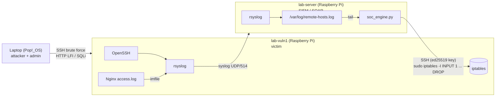

# Mini-SOC & Incident Response Lab

A home Security Operations Center built on physical hardware: two Raspberry Pis and a laptop.
Logs from a victim endpoint are centralized over syslog, a Python engine detects SSH brute
force and web attacks in real time, and an automated response (SOAR) blocks the attacker on
the victim's firewall over SSH, within seconds and with no human in the loop.

> Lab project for learning detection engineering and incident response. Not production software.

## Architecture



| Node | Role | Software |
|---|---|---|
| `lab-server` | SIEM + SOAR | rsyslog (receiver), `soc_engine.py` |
| `lab-vuln1` | Victim endpoint | Raspberry Pi OS, OpenSSH, Nginx, rsyslog (forwarder) |
| Laptop | Attacker / out-of-band management | ssh, curl, hydra |

### Data flow
1. **Telemetry**: `lab-vuln1` forwards all its logs (including `sshd` auth events) to `lab-server`
   over UDP 514. The Nginx access log is read by rsyslog's `imfile` module and tagged `nginx_access:`.
2. **Ingestion**: `lab-server` writes every remote message to `/var/log/remote-hosts.log`.
3. **Detection**: `soc_engine.py` tails that file and runs each line through the detection rules.
4. **Response**: when a rule fires, the engine SSHes into the victim and inserts an iptables
   `DROP` rule for the attacker's IP on the targeted port.

## Detection rules

| Rule | Logic | Response |
|---|---|---|
| SSH brute force | `Failed password for ...` from the same IP, ≥ `threshold` times within `window_seconds` (default 3 in 60 s) | Block IP on TCP 22 |
| Directory traversal / LFI | Decoded request URI matches `../`, `..\`, `/etc/passwd`, `/etc/shadow`, `/proc/self` | Block IP on TCP 80 |
| SQL injection | Decoded request URI matches `union select`, `' or '1'='1`, trailing `--`, `/* */`, `; drop table`, `; select` | Block IP on TCP 80 |

**Triage / false-positive handling**
- **Whitelist**: IPs or subnets in `whitelist` are never alerted on or blocked (gateway, SIEM node).
- **HTTP status**: requests without attack patterns are classified as `[SUSPICIOUS_WEB]` (4xx)
  or `[BENIGN_WEB]` (2xx).
- **Scope**: attack patterns are matched only against the parsed request URI. A payload in the
  User-Agent or Referer does not trigger a block.

**Response safety**
- Every IP taken from a log line is validated with Python's `ipaddress` before use, and the SSH
  command is built as an argument list (no `shell=True`), so attacker-controlled log data can't
  inject commands.
- `iptables -C` is checked before inserting, so a rule is never duplicated.
- The DROP is inserted at position 1 (`-I INPUT 1`), *above* the `ESTABLISHED,RELATED` accept
  rule, so the attacker's already-open connections are cut as well.
- Rules live only in RAM and disappear on reboot, which keeps the lab easy to reset.

## Repository layout

```
.
├── configs/
│   ├── config.example.json     # engine config template (copy to config.json)
│   ├── rsyslog-client.conf     # lab-vuln1 forwarder
│   ├── rsyslog-server.conf     # lab-server receiver (hardened)
│   └── 010_soc_automation      # sudoers drop-in for lab-vuln1
├── scripts/
│   └── soc_engine.py           # detection & response engine
├── systemd/
│   └── soc-engine.service      # run the engine as a service
├── LICENSE
└── README.md
```

## Setup

All IPs below are placeholders. Replace them with your own.

### 1. Victim node (`lab-vuln1`)

```bash
sudo apt install nginx openssh-server rsyslog
sudo cp configs/rsyslog-client.conf /etc/rsyslog.d/50-soc-forward.conf   # set the SIEM IP inside
sudo systemctl restart rsyslog

# allow the SOAR user to run iptables without a password
sudo visudo -f /etc/sudoers.d/010_soc_automation      # paste configs/010_soc_automation

# anti-lockout: keep already-established sessions alive
sudo iptables -A INPUT -m conntrack --ctstate ESTABLISHED,RELATED -j ACCEPT
```

### 2. SIEM node (`lab-server`)

```bash
# enable the UDP listener in /etc/rsyslog.conf:
#   module(load="imudp")
#   input(type="imudp" port="514")
sudo cp configs/rsyslog-server.conf /etc/rsyslog.d/10-remote.conf        # set the victim IP inside
sudo systemctl restart rsyslog

# SSH key for the automated response
ssh-keygen -t ed25519
ssh-copy-id <soar-user>@<victim-ip>

# the engine's user must be able to read the central log
sudo usermod -aG adm $USER        # log out and back in afterwards

git clone https://github.com/Miguel-Alessio/mini-soc-lab ~/mini-soc-lab && cd ~/mini-soc-lab
cp configs/config.example.json configs/config.json   # edit IPs, user, whitelist
```

### 3. Run

```bash
python3 scripts/soc_engine.py --dry-run    # detect only, prints what it would block
python3 scripts/soc_engine.py              # live mode
```

### 4. (Optional) Run as a systemd service

```bash
sed -i "s/YOUR_USER/$USER/" systemd/soc-engine.service
sudo cp systemd/soc-engine.service /etc/systemd/system/
sudo systemctl daemon-reload
sudo systemctl enable --now soc-engine
journalctl -u soc-engine -f
```

## Configuration

`configs/config.json`:

| Key | Meaning |
|---|---|
| `log_file` | Central log written by rsyslog |
| `target.host` / `target.user` / `target.ssh_key` | Victim node and the SSH identity used for the response |
| `whitelist` | IPs or CIDR subnets that are never blocked |
| `ssh_bruteforce.threshold` / `window_seconds` | Failures per IP within the sliding window that trigger a block |
| `response.enabled` | `false` = detect and alert only |
| `response.dry_run` | `true` = log the block action without executing it (same as `--dry-run`) |

The engine also reads the config path from `$SOC_CONFIG` or `-c <path>`.

## Test scenarios

Run from the attacker laptop. Make sure the laptop's IP is **not** in the whitelist.

**1. SSH brute force**
```bash
ssh wronguser@<victim-ip>            # enter a wrong password 3 times
# or: hydra -l root -P small-wordlist.txt ssh://<victim-ip>
```
Expected:
```
[!] [ALERT - SSH] Esec #3 pentru 'wronguser' de la 192.0.2.30
[CRITICAL INCIDENT] SSH Brute Force de la 192.0.2.30 - Blocare declansata
[ACTION SUCCESS] IP 192.0.2.30 blocat pe portul 22 (victima: 192.0.2.20)
```

**2. Directory traversal / LFI**
```bash
curl "http://<victim-ip>/index.php?file=../../etc/passwd"
curl --path-as-is "http://<victim-ip>/../../etc/passwd"   # --path-as-is stops curl normalizing ../
```
Expected: `[CRITICAL WEB INCIDENT] Local File Inclusion / Traversal detectat!` and a block on port 80.

**3. SQL injection**
```bash
curl "http://<victim-ip>/?id=1%27%20union%20select%201,2--%20"
curl "http://<victim-ip>/?user=admin%27%20or%20%271%27=%271"
```
Expected: `[CRITICAL WEB INCIDENT] SQL Injection detectat!` and a block on port 80.

**4. False-positive checks**
| Test | Expected |
|---|---|
| `curl http://<victim-ip>/` | `[BENIGN_WEB]`, no block |
| `curl http://<victim-ip>/doesnotexist` | `[SUSPICIOUS_WEB]` (404), no block |
| `curl -A "union select" http://<victim-ip>/` | `[BENIGN_WEB]`, payload in User-Agent is ignored |
| Any attack from a whitelisted IP | `[FALSE POSITIVE]`, no block |

Verify on the victim:
```bash
sudo iptables -L INPUT -n --line-numbers
```

## Recovery (you blocked yourself)

The block only covers the attacked port, and your laptop can still reach `lab-server`.
Use it as a jump host:

```bash
ssh <user>@<siem-ip>
ssh <soar-user>@<victim-ip> 'sudo iptables -L INPUT -n --line-numbers'
ssh <soar-user>@<victim-ip> 'sudo iptables -D INPUT <line-number>'    # remove one rule
```

Or reset everything (then re-add the anti-lockout rule):
```bash
sudo iptables -F INPUT
sudo iptables -A INPUT -m conntrack --ctstate ESTABLISHED,RELATED -j ACCEPT
```

A reboot of the victim also clears all rules.

## Known limitations & hardening ideas

- **Syslog over UDP is unauthenticated.** The hardened `rsyslog-server.conf` only accepts the
  victim's IP, but UDP source addresses can still be spoofed on the LAN. Next step: TCP with TLS
  or RELP between the nodes.
- **Broad sudo rights.** `NOPASSWD` on all of `iptables` means whoever compromises the SIEM node
  can also flush the victim's firewall. Better: a wrapper script (e.g. `/usr/local/sbin/soc-block`)
  that accepts only a validated IP and port 22/80, and allow only that in sudoers.
- **Regex-based web detection** is easy to evade (encoding tricks, case/whitespace games) and
  only sees what Nginx logs: GET URIs, not POST bodies. A real deployment would use a WAF
  (e.g. ModSecurity) or an IDS such as Suricata.
- **No automatic unblock.** Blocks last until reboot or manual removal. A TTL with automatic
  expiry would be the next feature.
- **In-memory state.** Counters and the blocked-IP list reset when the engine restarts.

## License

MIT, see [LICENSE](LICENSE).
